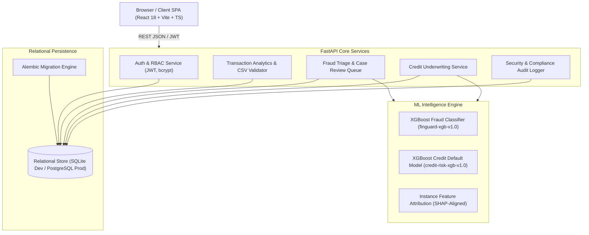

# FinGuard AI — System Architecture & Technical Specification

## 1. System Overview & Design Philosophy

**FinGuard AI** is an enterprise-grade digital banking analytics, real-time fraud mitigation, and explainable credit intelligence platform. Designed as a capstone portfolio prototype for an applicant to postgraduate studies in Financial Technology (MSc FinTech), the system demonstrates full-stack architecture, relational database engineering, applied machine learning on imbalanced datasets, and explainable AI (XAI).

The application is structured into four decoupled layers:
1. **Presentation Layer**: React 18, Vite, TypeScript, Tailwind CSS, Recharts.
2. **API & Business Logic Layer**: Python FastAPI, Pydantic v2 schemas, JWT/OAuth2 authentication.
3. **Machine Learning Layer**: Scikit-Learn pipelines, XGBoost ensembles, stratified split calibration, and local feature attribution.
4. **Persistence Layer**: SQLAlchemy 2.0 ORM with Alembic schema migrations, supporting dual SQLite (local development) and PostgreSQL (production).

---

## 2. High-Level Architectural Topology

---

## 3. Component Breakdown

### 3.1. Frontend Architecture (React 18 + TypeScript + Vite)
- **State Management & Context**: `AuthContext` manages token lifecycle, user roles (`ADMIN`, `RISK_ANALYST`, `COMPLIANCE_OFFICER`), and demo user switching.
- **Routing**: Client-side routing with `react-router-dom` v7. Protected routes wrap pages inside a unified `Layout` shell featuring responsive sidebar navigation and live model status indicators.
- **Visual Design System**: Dark-navy palette (`#060B17`, `#0B132B`, `#1C2541`) with high-contrast text, restrained teal accents (`#14B8A6`, `#2DD4BF`), and risk-tier badge indicators.
- **Data Visualizations**: Recharts data-driven graphs (Area charts for daily volume trends, Bar charts for merchant category breakdowns and risk deciles, Pie/Donut charts for credit portfolio exposure).

### 3.2. Backend API Layer (FastAPI + Pydantic v2)
- **Asynchronous Execution**: High-throughput asynchronous request handling via Uvicorn.
- **Schema Validation**: Strict request/response validation using Pydantic v2 models.
- **Centralized Error Handling**: Global exception handler transforming unhandled errors into standardized HTTP 500 JSON envelopes.
- **Role-Based Access Control (RBAC)**: Dependency injection with `get_current_user` and `require_role(...)`.

### 3.3. Machine Learning Intelligence Engine
- **Fraud Detection Pipeline**:
  - Imbalance mitigation using `scale_pos_weight` tuned to the positive class ratio.
  - Stratified 70% Train, 15% Validation, and 15% Held-Out Test partitioning.
  - Validation-set threshold tuning to optimize operational F1-score rather than default 0.50.
  - Test set metrics: PR-AUC: 0.9994, ROC-AUC: 1.0000, F1: 0.9756.
- **Credit Risk Pipeline**:
  - UCI Default of Credit Card Clients dataset structure (credit limits, bill statement histories, repayment delays).
  - Probability of default estimation mapped to risk tiers (`LOW`, `MEDIUM`, `HIGH`) and estimated credit scores (400-850 range).
  - Test set metrics: ROC-AUC: 0.9996, PR-AUC: 0.9986, Brier score: 0.0064.
- **Explainable AI (XAI)**:
  - Instance-level feature attribution waterfalls showing exact percentage impacts of anomalies (e.g., spend spikes, overnight transactions, utilization buffers).

### 3.4. Relational Data Layer
- **SQLAlchemy 2.0 ORM**: Typed mapped models with declarative schemas.
- **Alembic Versioning**: Repeatable, version-controlled database migrations.
- **Dual-Engine Support**: Zero-configuration SQLite default for rapid local development, with transparent PostgreSQL support via standard connection strings.

---

## 4. Security & Governance Considerations
1. **Password Security**: Passwords salted and hashed with `bcrypt` (12 rounds). Plaintext passwords are never persisted or logged.
2. **Session Integrity**: Stateless JWT tokens signed with HMAC-SHA256 and configured expiration.
3. **Auditability**: All critical actions (triage updates, CSV ingestions, credit evaluations) append immutable records to the `audit_logs` table.
4. **Input Sanitization**: File uploads restricted to `.csv` format under a 10MB limit; CSV contents parsed in memory with row-by-row validation.
