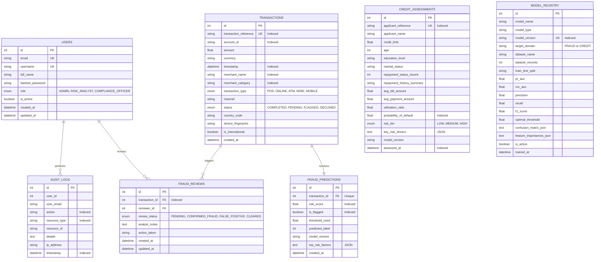

# FinGuard AI — Database Schema & Entity Relationships

This document outlines the relational database schema implemented in SQLAlchemy and managed with Alembic migrations.

---

## 1. Entity Relationship Diagram (ERD)

---

## 2. Table Specifications

### 2.1. `users`
| Column | Type | Constraints | Description |
|---|---|---|---|
| `id` | Integer | PK, Auto-increment | User identifier |
| `email` | String(255) | Unique, Indexed, Not Null | Work email address |
| `username` | String(100) | Unique, Indexed, Not Null | Institutional login handle |
| `full_name` | String(255) | Not Null | Display name |
| `hashed_password` | String(255) | Not Null | Bcrypt salted hash (12 rounds) |
| `role` | Enum | Not Null | `ADMIN`, `RISK_ANALYST`, `COMPLIANCE_OFFICER` |
| `is_active` | Boolean | Default True | Account status flag |
| `created_at` | DateTime | Default UTC | Creation timestamp |

### 2.2. `transactions`
| Column | Type | Constraints | Description |
|---|---|---|---|
| `id` | Integer | PK, Auto-increment | Internal identifier |
| `transaction_reference`| String(64) | Unique, Indexed | External reference (e.g., `TXN-2610-100234`) |
| `account_id` | String(64) | Indexed, Not Null | Customer account reference |
| `amount` | Float | Not Null | Transaction settlement value |
| `currency` | String(3) | Default `USD` | ISO-4217 Currency Code |
| `timestamp` | DateTime | Indexed, Not Null | Settlement execution timestamp |
| `merchant_name` | String(128) | Indexed, Not Null | Merchant entity name |
| `merchant_category`| String(64) | Indexed, Not Null | Spending sector (e.g., Groceries, Electronics) |
| `transaction_type` | Enum | Not Null | `POS`, `ONLINE`, `ATM_WITHDRAWAL`, `WIRE_TRANSFER`, `MOBILE_PAYMENT` |
| `channel` | String(32) | Default `WEB` | Access channel (`WEB`, `MOBILE_APP`, `IN_STORE`, `API`) |
| `status` | Enum | Not Null | `COMPLETED`, `PENDING`, `FLAGGED`, `DECLINED` |
| `country_code` | String(3) | Default `US` | Origin country |
| `device_fingerprint` | String(128)| Nullable | Device hash |
| `is_international` | Boolean | Default False | Cross-border transaction indicator |

**Composite Indices:**
- `idx_txn_timestamp_amount`: `(timestamp, amount)` — accelerates timeline range aggregations.
- `idx_txn_status_category`: `(status, merchant_category)` — accelerates categorical risk queries.

### 2.3. `fraud_predictions`
| Column | Type | Constraints | Description |
|---|---|---|---|
| `id` | Integer | PK | Prediction identifier |
| `transaction_id` | Integer | FK -> `transactions.id`, Unique | Cascade delete |
| `risk_score` | Float | Indexed, Not Null | XGBoost posterior probability (0.0000 - 1.0000) |
| `is_flagged` | Boolean | Indexed, Default False | True if `risk_score >= threshold_used` |
| `threshold_used` | Float | Default 0.65 | Operating decision threshold applied |
| `predicted_label` | Integer | 0 or 1 | Binary classification output |
| `model_version` | String(64) | Not Null | Serialized model artifact reference |
| `top_risk_factors` | Text | Nullable | JSON array of feature contributions |

### 2.4. `fraud_reviews`
| Column | Type | Constraints | Description |
|---|---|---|---|
| `id` | Integer | PK | Review ticket identifier |
| `transaction_id` | Integer | FK -> `transactions.id`, Indexed | Associated flagged transaction |
| `reviewer_id` | Integer | FK -> `users.id`, Nullable | Analyst who triaged the case |
| `review_status` | Enum | Indexed, Default `PENDING` | `PENDING`, `CONFIRMED_FRAUD`, `FALSE_POSITIVE`, `CLEARED` |
| `analyst_notes` | Text | Nullable | Investigation justification |
| `action_taken` | String(128) | Nullable | Operational action taken |
| `updated_at` | DateTime | Auto-updating | Timestamp of latest decision |

### 2.5. `credit_assessments`
| Column | Type | Constraints | Description |
|---|---|---|---|
| `id` | Integer | PK | Assessment identifier |
| `applicant_reference`| String(64) | Unique, Indexed | Application tracking reference |
| `applicant_name` | String(128) | Not Null | Applicant name |
| `credit_limit` | Float | Not Null | Authorized line of credit |
| `age` | Integer | Not Null | Applicant age |
| `education_level` | String(64) | Not Null | Education qualification |
| `marital_status` | String(32) | Not Null | Marital status |
| `repayment_status_recent`| Integer | Default 0 | Most recent repayment status (-1 to 4) |
| `utilization_ratio` | Float | Not Null | Balance to limit utilization |
| `probability_of_default`| Float | Indexed, Not Null | XGBoost default prediction probability |
| `risk_tier` | Enum | Indexed, Not Null | `LOW`, `MEDIUM`, `HIGH` |
| `key_risk_drivers` | Text | Nullable | JSON array of SHAP-aligned attributions |
| `assessed_at` | DateTime | Indexed, Default UTC | Assessment execution timestamp |

### 2.6. `model_registry`
Tracks all trained model artifacts, held-out test evaluation scores, optimal operating decision thresholds, and confusion matrices.

### 2.7. `audit_logs`
Immutable compliance audit trail tracking security events (`USER_LOGIN`), administrative ingestions (`IMPORT_TRANSACTIONS_CSV`), case updates (`UPDATE_FRAUD_REVIEW`), and underwriting decisions (`CREDIT_RISK_ASSESSMENT`).
