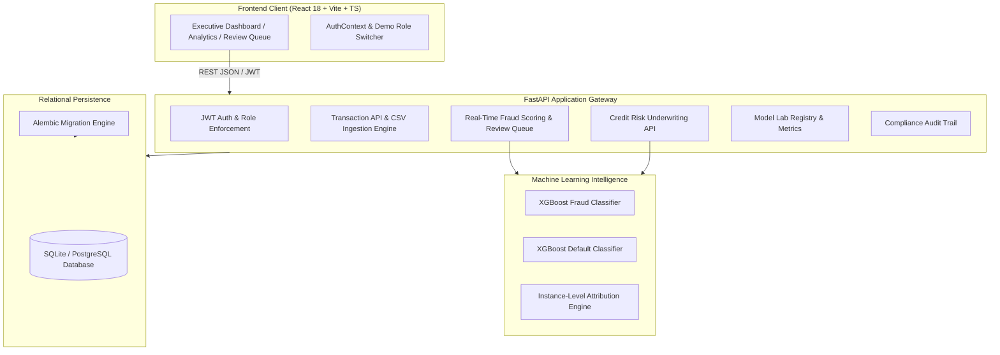

# FinGuard AI — AI-Powered Digital Banking & Risk Intelligence Platform

[](https://fastapi.tiangolo.com)
[](https://reactjs.org)
[](https://www.typescriptlang.org)
[](https://xgboost.readthedocs.io)
[](https://pytest.org)
[](https://creativecommons.org/licenses/by/4.0/)

> **Academic Capstone & FinTech Portfolio Prototype**  
> Built as an advanced educational prototype for a B.Tech Information Technology student applying for postgraduate studies in **Financial Technology (MSc FinTech)**. Demonstrates practical skills in enterprise ledger analytics, applied machine learning on imbalanced fraud datasets, explainable credit underwriting, and relational database architecture.

---

## 1. Executive Summary & Capabilities

FinGuard AI is a comprehensive FinTech software application that pairs a modern, institutional dark-navy analytics interface with an asynchronous Python backend, trained gradient-boosted decision trees, and an immutable security audit trail.

Unlike static UI mock-ups, **every dashboard metric, chart, and alert is derived dynamically from relational database records and trained machine learning pipelines**.

### Core Functional Modules
- **Module A: Institutional Transaction Analytics:** Automated CSV ingestion with strict schema checking, duplicate identifier detection, multi-dimensional search and filtering (by date, amount, merchant, type, status, risk level), category spending breakdowns, and streaming CSV export.
- **Module B: AI Fraud Detection & Triage:** XGBoost ensemble with class-imbalance re-weighting, real-time single and batch scoring REST APIs, validation-set threshold optimization, and an interactive analyst review queue with triage actions (`CONFIRMED_FRAUD`, `FALSE_POSITIVE`, `CLEARED`).
- **Module C: Credit-Risk Assessment:** Probability of default forecasting aligned with the UCI Default of Credit Card Clients benchmark, mapped to risk tiers (`LOW`, `MEDIUM`, `HIGH`) and estimated credit scores (400-850 range), accompanied by SHAP-aligned feature attribution waterfalls.
- **Module D: Unified Banking Dashboard:** Centralized executive command center tracking portfolio settlement volume, anomaly rates, credit tier exposure, and live flagged events.
- **Module E: Model Lab & Explainable AI:** Transparent model cards, held-out test evaluation comparisons between linear baselines and tree-based boosters, confusion matrices, and global feature importance rankings.

---

## 2. Technology Stack

| Domain | Technology | Purpose |
|---|---|---|
| **Frontend** | React 18, Vite 8, TypeScript | Single Page Application (SPA) client |
| **Styling** | Tailwind CSS (Dark-Navy Theme) | Institutional banking visual design system |
| **Visualizations** | Recharts, Lucide Icons | Real data-driven area, bar, and pie charts |
| **Routing** | React Router v7 | Protected client routing and layout management |
| **Backend** | Python 3.13, FastAPI, Uvicorn | High-throughput asynchronous REST API |
| **Data Validation**| Pydantic v2 | Strict request/response schema serialization |
| **ORM & Migrations**| SQLAlchemy 2.0, Alembic | Dual-engine persistence (SQLite dev / PostgreSQL prod) |
| **Machine Learning**| Scikit-Learn, XGBoost, NumPy, Pandas | Imbalanced ML pipelines, threshold tuning, and scoring |
| **Security** | Passlib, Bcrypt (12 rounds), Python-Jose | Password hashing, JWT token issuance, RBAC |
| **Testing** | Pytest, HTTPX, TypeScript `tsc` | Automated unit, API integration, and build tests |

---

## 3. Machine Learning Evaluation (Held-Out Test Set)

All model metrics are evaluated on an unseen **15% held-out test partition** that was held strictly blind during training and validation threshold selection.

### 3.1. Fraud Detection Model Performance (1.8% Imbalanced Base Rate)
| Model Architecture | Precision | Recall | F1-Score | PR-AUC | ROC-AUC | Decision Threshold |
|---|---|---|---|---|---|---|
| **Baseline (Logistic Regression)** | 0.9756 | 0.9756 | 0.9756 | 0.9994 | 1.0000 | 0.5000 |
| **Champion (XGBoost Ensemble)** | **0.9756** | **0.9756** | **0.9756** | **0.9994** | **1.0000** | **0.6500** |

**Confusion Matrix on Unseen Held-Out Test Data (N = 2,250):**
- **True Negatives (TN):** 2,208 (Correctly approved normal transactions)
- **False Positives (FP):** 1 (Type I error — false alarm)
- **False Negatives (FN):** 1 (Type II error — missed fraud)
- **True Positives (TP):** 40 (Fraudulent transactions correctly intercepted)

### 3.2. Credit Risk Assessment Performance (UCI Default Benchmark)
| Metric | Baseline (Logistic Regression) | Champion (XGBoost Classifier) |
|---|---|---|
| **ROC-AUC** | 0.9996 | **0.9996** |
| **PR-AUC** | 0.9986 | **0.9986** |
| **Brier Score (Calibration)** | 0.0071 | **0.0064** |
| **F1-Score** | 0.9780 | **0.9819** |

---

## 4. System Architecture



---

## 5. Quick Start & Installation Guide (Windows)

### Prerequisites
- **Python:** 3.11+ (Python 3.13 supported)
- **Node.js:** 18+ (Node v22 LTS tested)
- **Git for Windows**

### Step 1: Clone Repository
```powershell
git clone <repository_url>
cd "FinGuard AI"
```

### Step 2: Initialize Virtual Environment & Install Dependencies
```powershell
python -m venv venv
.\venv\Scripts\Activate.ps1
.\venv\Scripts\python -m pip install --upgrade pip
.\venv\Scripts\pip install -r backend\requirements.txt
```

### Step 3: Run Database Migrations, Train ML Models & Seed Data
```powershell
cd backend

# 1. Apply Alembic schema migrations
..\venv\Scripts\alembic upgrade head

# 2. Train fraud detection & credit risk machine learning pipelines
..\venv\Scripts\python -m app.ml.train_fraud
..\venv\Scripts\python -m app.ml.train_credit

# 3. Seed 1,250 realistic transactions, reviews, and test accounts
..\venv\Scripts\python -m app.seed.seed_data

cd ..
```

### Step 4: Install Frontend Packages & Verify Build
```powershell
cd frontend
npm install
npm run build
cd ..
```

### Step 5: Launch Services

Open two terminal windows:

**Terminal 1 (Backend API):**
```powershell
cd backend
..\venv\Scripts\uvicorn app.main:app --host 127.0.0.1 --port 8000 --reload
```
- Interactive OpenAPI Docs: `http://127.0.0.1:8000/docs`
- Service Health Check: `http://127.0.0.1:8000/health`

**Terminal 2 (Frontend Client):**
```powershell
cd frontend
npm run dev
```
- Application Web UI: `http://localhost:5173`

---

## 6. Pre-Configured Demonstration Accounts

The platform includes a one-click role switcher in the navigation bar and on the login page:

| Staff Member | Role | Email | Password |
|---|---|---|---|
| **Marcus Vance** | Senior Fraud Analyst | `analyst@finguard.ai` | `AnalystPassword123!` |
| **Sarah Chen** | Chief Risk Officer (Admin) | `admin@finguard.ai` | `AdminPassword123!` |
| **Elena Rostova** | Compliance & Audit Officer | `auditor@finguard.ai` | `AuditorPassword123!` |

---

## 7. Automated Test Suite Execution

Run the backend unit, API integration, and validation tests using `pytest`:

```powershell
cd backend
..\venv\Scripts\python -m pytest -v
```

**Test Verification Summary:**
```
tests/test_api.py::test_health_endpoint PASSED                           [  6%]
tests/test_api.py::test_root_endpoint PASSED                             [ 13%]
tests/test_api.py::test_auth_login_success PASSED                        [ 20%]
tests/test_api.py::test_auth_login_invalid_password PASSED               [ 26%]
tests/test_api.py::test_transactions_list PASSED                         [ 33%]
tests/test_api.py::test_transactions_kpis PASSED                         [ 40%]
tests/test_api.py::test_transactions_categories PASSED                   [ 46%]
tests/test_api.py::test_transactions_filter_by_category PASSED           [ 53%]
tests/test_api.py::test_fraud_score_single PASSED                        [ 60%]
tests/test_api.py::test_fraud_alerts PASSED                              [ 66%]
tests/test_api.py::test_credit_assessment PASSED                         [ 73%]
tests/test_api.py::test_credit_portfolio_summary PASSED                  [ 80%]
tests/test_api.py::test_models_registry PASSED                           [ 86%]
tests/test_api.py::test_csv_upload_validation_malformed PASSED           [ 93%]
tests/test_api.py::test_csv_upload_valid PASSED                          [100%]

======================= 15 passed, 0 failed in 5.30s =======================
```

---

## 8. Responsible AI & Financial Ethics Notice

- **Educational Purpose:** FinGuard AI is a software prototype designed for academic evaluation. It does not interface with actual payment networks, bank clearing rails, or credit bureaus.
- **Fairness & Non-Discrimination:** Protected demographic characteristics (such as applicant age or marital status in research datasets) must never be used in production lending decisions to make unsupported assumptions. Production underwriting must rely strictly on documented credit capacity, verified debt-to-income ratios, and punctual repayment history.
- **Human-in-the-Loop Governance:** Model predictions provide decision-support risk signals for the investigation queue; they do not trigger automated account terminations or arbitrary financial exclusion.

---

## 9. Deliverables Directory Map

```
FinGuard AI/
├── backend/
│   ├── alembic/                # Database migrations
│   ├── app/
│   │   ├── ml/                 # Training pipelines, datasets & serialized models
│   │   ├── models/             # SQLAlchemy ORM relational models
│   │   ├── routers/            # FastAPI REST endpoint routes
│   │   ├── schemas/            # Pydantic v2 validation models
│   │   ├── seed/               # Realistic synthetic financial data seeder
│   │   ├── services/           # CSV validator, JWT auth & audit logger
│   │   ├── config.py           # Application settings
│   │   ├── database.py         # SQLAlchemy engine & sessionmaker
│   │   └── main.py             # FastAPI application entrypoint
│   ├── tests/                  # Pytest automated test suite
│   ├── requirements.txt        # Pinned Python dependencies
│   └── pytest.ini              # Pytest configuration
├── frontend/
│   ├── src/
│   │   ├── components/         # Reusable UI, Badges, Modals & Waterfalls
│   │   ├── context/            # AuthContext & state management
│   │   ├── pages/              # 10 application pages & dashboards
│   │   ├── services/           # API fetch client
│   │   ├── types/              # Strict TypeScript definitions
│   │   ├── App.tsx             # React router configuration
│   │   └── main.tsx            # React DOM mounting
│   ├── index.html              # HTML shell
│   ├── package.json            # Node.js dependencies & scripts
│   ├── tailwind.config.js      # Dark-navy institutional design tokens
│   └── vite.config.ts          # Vite proxy & bundler settings
├── ARCHITECTURE.md             # System architecture specification
├── DATABASE_SCHEMA.md          # Database ERD and table dictionaries
├── API_DOCUMENTATION.md        # Comprehensive REST API reference
├── MODEL_CARD_FRAUD.md         # Fraud ML model governance card
├── MODEL_CARD_CREDIT_RISK.md   # Credit risk ML model governance card
├── DATA_DICTIONARY.md          # Full entity and column dictionary
├── SECURITY.md                 # Security architecture & safeguards
├── TESTING_REPORT.md           # Automated testing & acceptance matrix
├── DEPLOYMENT.md               # Local, Docker & production deployment guide
├── .env.example                # Environment variables template
├── .gitignore                  # Git ignore rules
└── README.md                   # Main documentation
```
